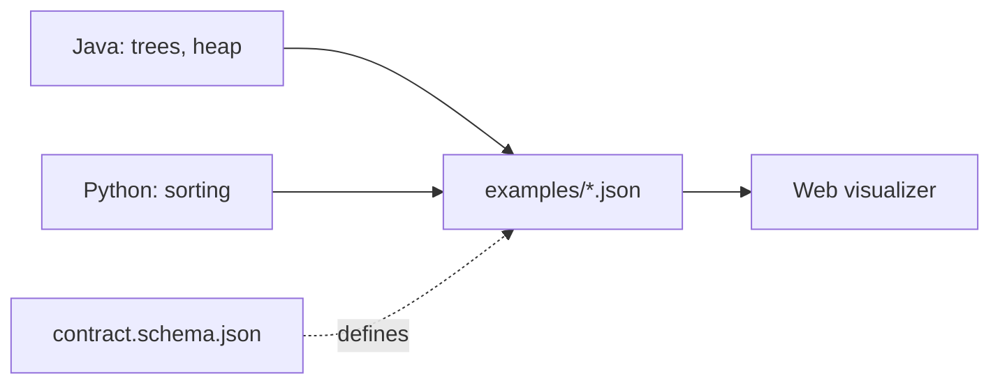

# Algorithm & Data Structures Visualizer

Step-by-step visualization of classic data structures and sorting algorithms. The implementations in Java
and Python record every operation as a list of steps. A web page without frameworks plays those steps back.

## Overview & Architecture

The parts share one thing: a JSON contract, [`contract.schema.json`](contract.schema.json).

- **Java** implements search trees and a heap, and records their operations.
- **Python** implements sorting algorithms, and records them in the same format.
- **Web** reads the recorded JSON and draws it. It contains no algorithm code.



Every step holds a full snapshot of the structure. The player can therefore jump to any step or go back
without replaying anything, and a new algorithm in any language only has to write the same JSON.

```text
.
├── contract.schema.json      JSON Schema of the step format
├── examples/                 recorded operations, built-in scenarios of the web page
├── src/
│   ├── main/java/visualizer/
│   │   ├── Main.java         writes the Java examples
│   │   ├── steps/            Step and OperationResponse, the contract in Java
│   │   ├── trees/            BST, AVL tree, red-black tree
│   │   └── heaps/            min-heap
│   └── test/java/visualizer/ JUnit tests
├── python/
│   ├── sorting/              sorting algorithms and step recording
│   └── tests/                unittest suite
└── web/
    ├── index.html            page
    ├── app.js                scenario loading and player
    ├── contract.js           contract check
    ├── tree-view.js          trees and heaps as SVG
    ├── array-view.js         arrays as cells and bars
    └── tests/                checks for Node's built-in test runner
```

## Implemented Algorithms & Data Structures

### Java (`visualizer.*`)

| Structure | Operations | Time | Recorded steps include |
|-----------|------------|------|------------------------|
| Binary search tree, `SimpleBinarySearchTree` | insert, remove | O(h) | comparisons, successor replacement |
| AVL tree, `AVLTree` | insert, remove | O(log n) | imbalance, single and double rotations |
| Red-black tree, `RBTree` | insert, remove | O(log n) | recoloring, rotations, double black |
| Min-heap, `MinHeap` | insert, extract min | O(log n) | sift up, sift down, swaps |

`h` is the height of the tree. The trees reject duplicate keys, the heap accepts them.

Randomized tests compare the trees with `java.util.TreeSet` and the heap with `java.util.PriorityQueue`.
After every operation they also check the invariants: parent links, AVL balance and cached heights,
red-black color rules and black height, and the heap order.

### Python (`python/sorting`)

| Algorithm | Best | Average | Worst | Stable |
|-----------|------|---------|-------|--------|
| Bubble sort, stops early when sorted | O(n) | O(n²) | O(n²) | yes |
| Insertion sort | O(n) | O(n²) | O(n²) | yes |
| Quick sort, Lomuto partition with the last element as pivot | O(n log n) | O(n log n) | O(n²) | no |
| Merge sort, top-down | O(n log n) | O(n log n) | O(n log n) | yes |

Each function sorts a copy of its input and stores a snapshot of the whole array in every step.

The complexities above describe the algorithms. Recording adds an O(n) snapshot per step, so the project is
meant for inputs small enough to watch.

## Unified Step JSON Contract

A file describes one operation:

| Field | Meaning |
|-------|---------|
| `structure` | `bst`, `avl`, `rb`, `heap` or `array` |
| `operation` | name of the operation, for example `insert`, `delete`, `extract_min`, `quick_sort` |
| `value` | inserted or removed key, extracted minimum, or input array of a sort |
| `steps` | non-empty list of steps |

Each step has exactly these fields:

| Field | Meaning |
|-------|---------|
| `index` | position of the step, starting at 0 |
| `action` | what happened, for example `compare`, `swap`, `rotate_left`, `recolor`, `done` |
| `at` | node id for trees; index or pair of indexes for heaps and arrays; `null` if no single element is involved |
| `comment` | explanation for the viewer |
| `state` | full snapshot **after** the action: a nested tree node (`null` for an empty tree) or an array |

A step from [`examples/example-heap-insert.json`](examples/example-heap-insert.json):

```json
{
  "index": 3,
  "action": "swap",
  "at": [6, 2],
  "comment": "Swap 3 and 8",
  "state": [5, 10, 3, 20, 15, 9, 8]
}
```

Tree nodes have `id`, `value`, `left` and `right`. AVL nodes add `height` and `balance`, red-black nodes add
`color`. An `id` never changes, so a node can be followed through rotations and key copies.

Details worth knowing:

- Step indexes are consecutive, the last action is always `done`, and node ids are unique within one state.
  JSON Schema cannot express these rules, so the tests and the web page check them.
- The `at` of a tree `delete` step is the removed node, which is no longer in `state`.
- The `at` pair of a `merge` step is a range of indexes.

All recorded operations are in [`examples/`](examples/):

| Scenario | File |
|----------|------|
| AVL tree: insert 65 | [`example-insert.json`](examples/example-insert.json) |
| AVL tree: delete 50 | [`example-delete.json`](examples/example-delete.json) |
| BST: insert 45 | [`example-bst-insert.json`](examples/example-bst-insert.json) |
| BST: delete 50 | [`example-bst-delete.json`](examples/example-bst-delete.json) |
| Red-black tree: insert 60 | [`example-rb-insert.json`](examples/example-rb-insert.json) |
| Red-black tree: delete 50 | [`example-rb-delete.json`](examples/example-rb-delete.json) |
| Min-heap: insert 3 | [`example-heap-insert.json`](examples/example-heap-insert.json) |
| Min-heap: extract min | [`example-heap-extract.json`](examples/example-heap-extract.json) |
| Quick sort | [`example-quick-sort.json`](examples/example-quick-sort.json) |
| Merge sort | [`example-merge-sort.json`](examples/example-merge-sort.json) |

## How to Run & Test

Run all commands from the repository root. Each part works on its own:

| Part | Needs |
|------|-------|
| Java | JDK 21 (the Gradle wrapper downloads Gradle) |
| Python | Python 3; `jsonschema` for the tests only |
| Web page | a browser and any static file server |
| JavaScript tests | Node.js 18 or newer, no packages |

### Web visualizer

```bash
python3 -m http.server 8000
```

Open <http://localhost:8000/web/> and pick a scenario. Opening `web/index.html` from disk (`file://`) only
shows a hint to start the server, because browsers do not let such a page read `examples/`.
Keyboard shortcuts are listed in [`web/README.md`](web/README.md).

### Java

```bash
./gradlew clean test
```

On Windows use `gradlew.bat`. The tests fail if a Java example is out of date. To regenerate the examples,
run `visualizer.Main` from an IDE with the repository root as working directory.

### Python

```bash
python3 -m pip install -r python/requirements.txt
```

```bash
python3 -m unittest discover -s python/tests -t python
```

The tests also validate every file in `examples/` against `contract.schema.json`. To regenerate the
sorting examples:

```bash
PYTHONPATH=python python3 -m sorting
```

### JavaScript

```bash
node --test web/tests/visualizer.test.js
```

Checks that `web/contract.js` agrees with the schema, that broken files are rejected, and that tree layout
and edge matching are correct.
